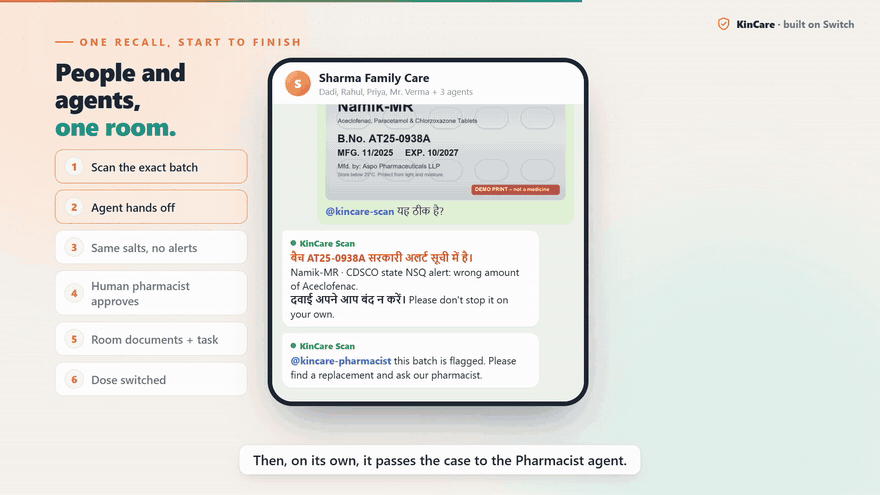
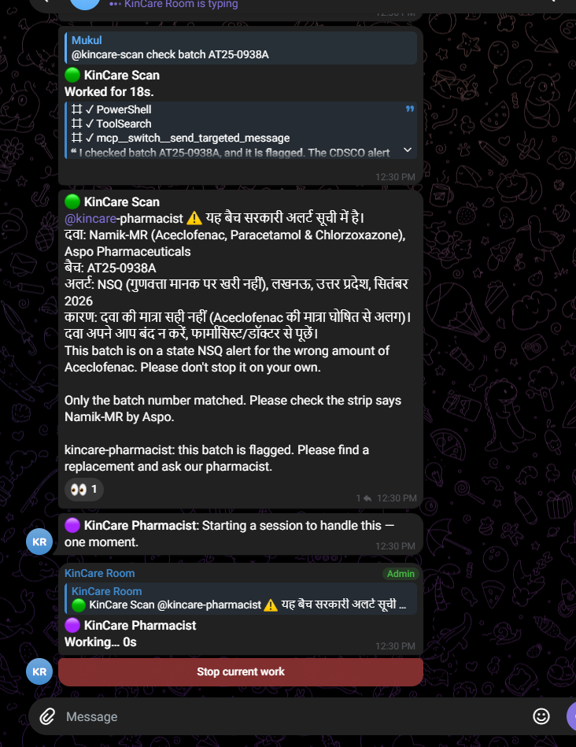
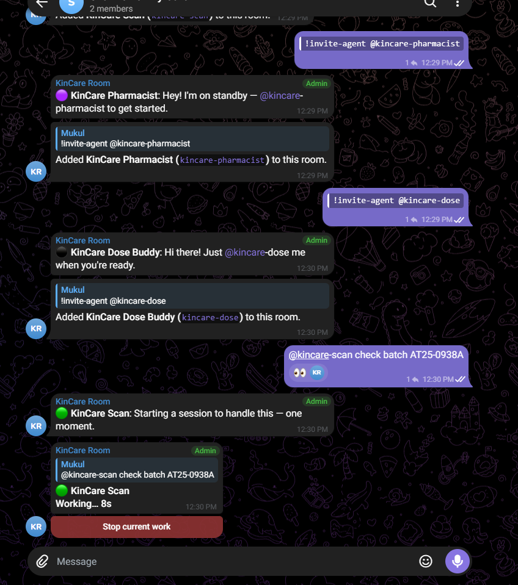
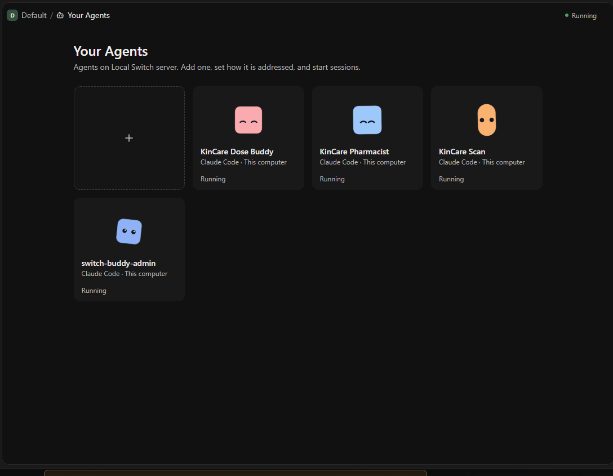
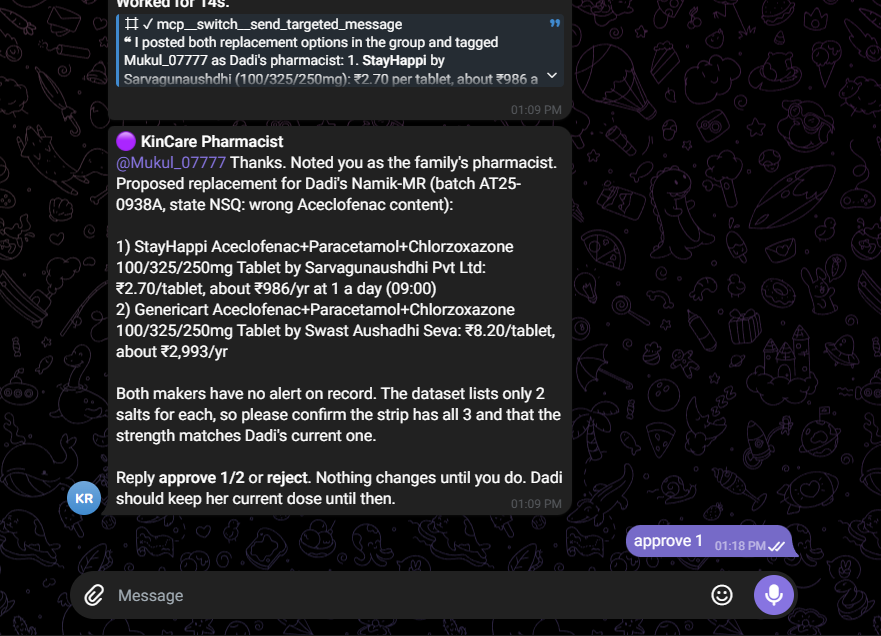
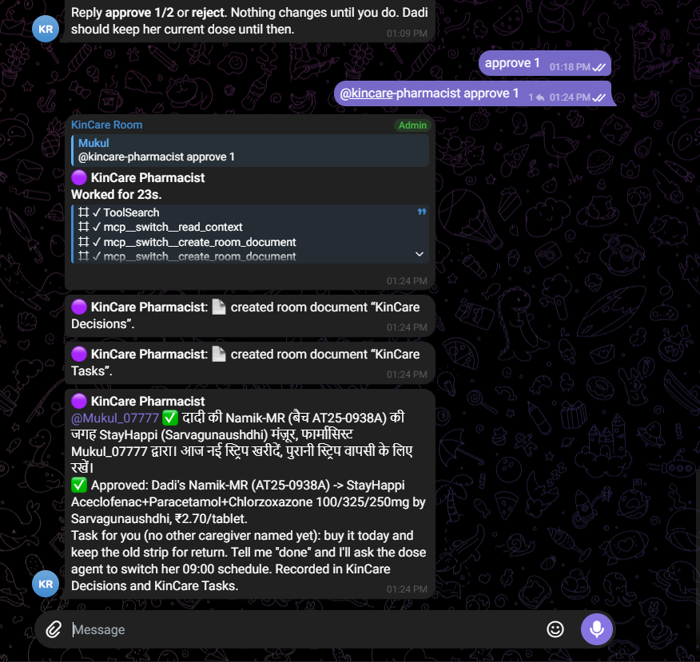
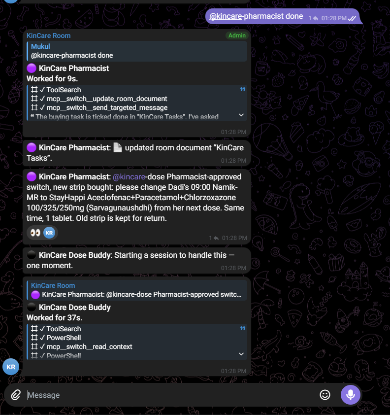

# KinCare: know the batch, decide together

[](https://github.com/Mukul07777/KinCare/actions/workflows/ci.yml)

**A family, their pharmacist and AI agents in one chat room, keeping an elder's medicines safe.**
Built on [Switch](https://github.com/sandbox-quantum/switch) for the Flip the Switch hackathon (Track 01: Best Business Workflow).

**[▶ Watch the demo (under 3 min)](https://youtu.be/LSpxSnIVH5U)**



Team Avengers: Mukul (lead), Ashpreet Singh Saini.

### Live in a real Telegram group, run by Switch

| Scan agent flags the batch and hands off | Agents invited into the family group | The agents in Switch Console |
|---|---|---|
|  |  |  |

Each agent is Claude Code run by Switch Console on this computer. Telegram is linked to a Switch room, and the scan
agent passes the flagged batch to the pharmacist agent by @mention in the same room.

| Pharmacist agent proposes, nothing changes yet | The human pharmacist approves; decision and task saved as room documents | "done" ticks the task; the dose agent takes over |
|---|---|---|
|  |  |  |

---

## The problem nobody tells you about

India's drug regulator (CDSCO) publishes the batches that failed a quality test or turned out to be fake.
We pulled **7,920 real alerts (2019 to 2026)** from its public portal and monthly alert PDFs, and measured the gap
(using the manufacture and expiry dates printed on each alert):

- A failed batch reaches the CDSCO list a median **10 months** after it was made.
- When it is listed, **99.6%** of those batches are still within expiry, with a median **14 months** left.
- So the medicine is still in homes, and people are still taking it. **Nobody tells them.**
- It is not rare: **2,257 batches** were flagged in the 11 months from Nov 2025 to Sep 2026, about **200 a month**
  (322 in Sep 2026 alone).
- It hits elders' daily medicines: at least **1,940 alerts (24.5%)** are for blood pressure and heart (514),
  diabetes (191), cholesterol (95), pain and fever (764) or calcium and vitamin D (409) medicines. That is a lower
  bound, matched on salt and a few brand names in the alert. Reproduce: `cd api && .venv\Scripts\python impact_stats.py`.

And looking after an elder's medicines is a team job: Dadi takes them, her son lives in another city,
her daughter buys them, the local pharmacist knows what to replace them with. Today that "team" is a
messy WhatsApp group where a government PDF never arrives.

### Why this is new

- **The agent speaks first.** Chat agents usually wait to be asked. KinCare's Recall Watcher raises the alarm in
  the room on its own, the moment a new government alert matches a batch the family owns.
- **The pharmacist approves, the agent proposes.** A professional signs off on every replacement in the chat,
  and the decision is written to a room document everyone reads. No chatbot verdict on medicine.
- **One alert, every home it reached.** The Pharmacy Desk room turns one flagged batch into action across every
  family room linked to that pharmacy, instead of one PDF nobody opens.

## What KinCare does

KinCare turns that family group into a **Switch room** where people and agents work together:

```
 Telegram group "Sharma Family Care"  (a Switch room)
 ─────────────────────────────────────────────────────────────────────────────
 Dadi            [photo of a Namik-MR strip]  @kincare-scan
 KinCare Scan    ⚠️ बैच AT25-0938A सरकारी जाँच में फेल। This batch is on the CDSCO
                 Not of Standard Quality list. @kincare-pharmacist please find a replacement.
 KinCare Pharm.  Proposed for Dadi (same three salts, makers with no CDSCO alerts):
                 1) StayHappi Aceclofenac+Chlorzoxazone+Paracetamol 100/325/250 mg, ₹2.70/tablet
                 2) Genericart Aceclofenac+Paracetamol+Chlorzoxazone 100/325/250 mg, ₹8.20/tablet
                 @Pharmacist reply approve 1/2 or reject. Nothing changes until you do.
 Pharmacist      approve 1
 KinCare Pharm.  ✅ Decision logged. Task: @Rahul buy StayHappi today, keep the old strip for return.
 Rahul           done, bought
 KinCare Dose    दादी, कल सुबह 9 बजे से नई दवा: StayHappi, 1 गोली।
 ─────────────────────────────────────────────────────────────────────────────
 Room documents:  KinCare Decisions · KinCare Tasks   (everyone reads the same record)
```

| Agent | Kind | What it does |
|---|---|---|
| **kincare-recall-watcher** | Custom Switch protocol agent (Python) | Speaks first: checks the family's batches against new CDSCO alerts and raises the alarm in the room |
| **kincare-scan** | Claude Code agent run by Switch Console | Reads a strip or bill photo (KinCare's own OCR), checks the exact batch, answers in Hindi + English |
| **kincare-pharmacist** | Claude Code agent run by Switch Console | Finds the same salts from a maker with no alerts and the saving, **asks the human pharmacist**, records the decision and the task |
| **kincare-dose** | Claude Code agent run by Switch Console | Dose schedule, "what's due?", missed-dose nudge to a caregiver, switches the schedule after an approved replacement |

### One recall, many homes: the Pharmacy Desk

A pharmacist serves hundreds of families. When a batch is flagged, the Recall Watcher posts one
**blast radius** in the pharmacist's own *Pharmacy Desk* room (linked to every family room):

```
📡 Blast radius: Namik-MR batch AT25-0938A (CDSCO NSQ, 2026-09) is in 3 homes served by Verma Medicos
  • Sharma: Dadi, doses at 09:00 (caregiver Rahul)
  • Khan: Abbu, doses at 09:00, 21:00 (caregiver Imran)
  • Gupta: Nani, doses at 21:00 (caregiver Neha)
Mr. Verma   approve all
```

One approval, and every family room gets its own decision and task. Families never see each other;
only the desk sees the whole list. ([`switch/network.json`](switch/network.json): the pharmacy's families.)

### When the doctor must approve too

For narrow-range medicines (blood thinners, thyroid hormone, epilepsy, diabetes, heart rhythm), a different
maker's tablet can need a dose check. KinCare knows which, and asks for **both** approvals:
real example, *Thyrox 50, batch H26MAB011* (CDSCO NSQ, Sep 2026, failed dissolution): the pharmacist approves,
Nani's doctor approves (relayed by Neha), and the decision is logged with the doctor's follow-up: *TSH in 6 weeks*.
Replacements always match **salts, form and strength**: a 50 mcg thyroxine is never offered as 25 mcg.

**Humans decide, agents do the legwork.** Room rules (in the template) forbid any agent from telling anyone
to stop or switch a medicine; only the pharmacist or a doctor approves, and that approval is what gets logged.

### Who pays

- **Families: free.** Checking a batch is never behind a paywall.
- **Pharmacies pay (planned ₹499/month).** One Pharmacy Desk room shows every family a flagged batch reached,
  keeps a logged record of who approved each replacement, and brings the customer back to the counter for the swap.
- **Why a pharmacist adopts it:** CDSCO's 2024 recall guideline gives retailers recall duties too. KinCare turns that
  duty into a few chat messages. Prices are hypotheses for pilots; see [docs/BUSINESS.md](docs/BUSINESS.md).

## Why this needs Switch

Take Switch away and KinCare is a one-person app again. The whole idea is a **shared room**:

- **People and agents together, with roles**: elder, caregivers, pharmacist, four agents, one chat the family already uses (Telegram).
- **Agents hand off to each other in the open**: watcher → pharmacist agent → human pharmacist → dose agent, each by @name, visible to the family.
- **One shared record**: decisions and tasks live in the room's documents, not in someone's head.
- **Two ways of joining a room, both used**: three Claude Code agents run by Switch Console, and one custom agent speaking the Switch agent protocol (`POST /agents`, `POST /agents/{id}/message`), because a recall alert must arrive without anyone asking.
- **One-click setup**: a Switch template creates the agents, and (for Slack/Discord) a linked Family Care + Pharmacy Desk room group with roles, rules and shared documents. Checked with Switch's own template linter and compiler.
- **Roles that mean something**: only the person holding the exclusive `pharmacist` role can approve a change; a family member's "approve" is politely refused.

## Run it in Switch

You need Windows, macOS or Linux, Python 3.12, [Switch Console](https://docs.switchagents.ai/switch-rooms/getting-started/install-switch-console) with Claude Code as the provider, and a Telegram bot.

1. **KinCare API and data**: double-click `start_switch.bat` (macOS / Linux: `./start_switch.sh`). The first run loads the real CDSCO alerts and 246k medicine brands (a few minutes).
2. **Telegram**: create a bot with @BotFather, **turn Group Privacy off**, then in Switch Console: Connectors → Telegram. Make a group, add the bot. ([Switch docs](https://docs.switchagents.ai/switch-rooms/deploy/messaging-apps/telegram))
3. **Agents and room**: Switch Console → Templates → Import template → [`switch/kincare-room.template.yaml`](switch/kincare-room.template.yaml) → Use template. Set *KinCare folder* to this repository, then choose:
   - **Telegram group**: the agents join the family group you made (Switch can't create Telegram chats), or
   - **New rooms**: a linked *Family Care* + *Pharmacy Desk* group with roles (`elder`, `caregiver`, exclusive `pharmacist`) and the shared documents *KinCare Decisions*, *KinCare Tasks* and *KinCare data sources*. For Slack, Discord or Console.
4. **Recall Watcher**: fill `switch/.env` (from [`switch/.env.example`](switch/.env.example)), then
   `api\.venv\Scripts\python switch\recall_watcher.py register` (macOS / Linux: `api/.venv/bin/python switch/recall_watcher.py register`), add **kincare-recall-watcher** to the room in Console, and run the start script again.
   It stays connected to Switch: it alerts on its own every few minutes, and answers `@kincare-recall-watcher check` / `status` / `help`.
5. **Try it**: in the group, send a strip photo with `@kincare-scan`, or write `@kincare-recall-watcher check`.

Demo data: [`switch/family.json`](switch/family.json) holds a simulated family. **The batch AT25-0938A and its alert are real** (CDSCO NSQ list, Sep 2026); the family and pharmacist are simulated.

## No Telegram? Watch the offline replay

KinCare is built to run in a Switch room (above). For judges without Switch Console or a Telegram bot, this
replays the same messages and room documents in your terminal. It is a replay of what the agents do, not a
second version of the product.

```bat
start_switch.bat                                   :: first run loads the real data, then starts the API
api\.venv\Scripts\python switch\demo_local.py     :: the family room in your terminal; you are the pharmacist
```

macOS / Linux: `./start_switch.sh`, then `api/.venv/bin/python switch/demo_local.py`.

`demo_local.py` plays the same flow the Switch agents run, on the same real data: OCR on a strip photo,
the CDSCO match, safe same-salt options, your approval, and the room's *KinCare Decisions* and *KinCare Tasks*
documents written to `switch/demo_out/`. Add `--auto` to play every part.

Prefer a screen? `run.bat` opens the web app: **Care network** (`/network`) shows the same thing visually: the four
agents, the Pharmacy Desk with each recall's blast radius, the doctor gate, every family room, a Telegram-style
replay of the conversation, and the *Decisions* and *Tasks* documents filling in as you approve.

## Scope: what to judge

The hackathon entry is one loop, and it works end to end in Telegram and in `demo_local.py`:

**recall alert → scan the exact batch → pharmacist agent proposes a replacement → human pharmacist approves → task to family → dose schedule switches.**

Everything that loop touches: [`switch/`](switch/), and in the API the ingest, matcher, OCR, medicines, prices,
blast radius and Switch room routes. The rest of the web app (SOS, live vitals, billing, regulator pages, check-ins)
was in our earlier app, Carely. It still works, but the Switch workflow does not use it.

## How it is built

```
 Telegram ──► Switch server (rooms, people, roles, documents) ◄── Switch Console runs Claude Code agents
                    ▲                                                 │  scan · pharmacist · dose
                    │ POST /agents/{id}/message                       │  (instructions: switch/agents/*/AGENT.md)
                    │                                                 ▼
          recall_watcher.py ──────────────► switch/kincare_cli.py ──► KinCare API (FastAPI, :8000)
          (custom protocol agent)            (one tool, stdlib only)   CDSCO alerts · OCR · 246k medicines
```

| Path | What |
|---|---|
| [`switch/`](switch/) | **New for this hackathon**: agent instructions, CLI, Recall Watcher, room template, tests |
| [`docs/SWITCH_NOTES.md`](docs/SWITCH_NOTES.md) | How Switch works and how KinCare uses it |
| [`docs/BLOG.md`](docs/BLOG.md) | Build write-up for first-time Switch users |
| [`api/`](api/) | KinCare API: CDSCO ingest, batch matcher, OCR, prices, care plans |
| [`web/`](web/) | KinCare web app (optional for the Switch workflow) |

Tests: `api\.venv\Scripts\python -m pytest switch -q` (Switch layer) and `cd api && .venv\Scripts\python -m pytest -q` (KinCare API, tests in `api/tests/`). OCR benchmark: `cd api && .venv\Scripts\python bench_strips.py`.

## What is new for Flip the Switch

KinCare's API and web app began as our earlier project (Carely, HackIIITD 2026); see [docs/KINCARE_APP.md](docs/KINCARE_APP.md).
Everything that puts it in a team room is new and built during this hackathon: the four Switch agents and their
instructions, the custom protocol Recall Watcher, the agent CLI, the room template with its safety rules,
the decision and task workflow, and the tests in `switch/`.

## Data and safety

- Alerts: CDSCO public NSQ and spurious-drug portal plus monthly alert PDFs. Medicines: Indian Medicine Dataset (MIT).
- OCR, measured with [`api/bench_strips.py`](api/bench_strips.py) on strip photos labelled by a person
  ([`api/tests/strips/labels.csv`](api/tests/strips/labels.csv)):

  | Set | Photos | Batch | Expiry | Brand | Median time |
  |---|---|---|---|---|---|
  | Real phone photos (WhatsApp) | 5 | 100% | 100% | 80% | 5.5 s |
  | Demo strip prints | 5 | 100% | 100% | 100% | 2.0 s |

  That is a small set, so it is evidence, not proof. If OCR misreads or finds no batch, anyone in the room can
  type the batch number (`AT25-0938A`), or the scan agent asks for a closer photo of the "B.No." line.
  The agent never guesses a batch.
- Batch numbers are matched exactly; a near miss never raises an alert.
- KinCare never says a medicine is "safe" or "genuine", only whether a batch is on an alert list.
- No agent ever advises stopping or switching a medicine. A human pharmacist or doctor approves.
- Health data stays in the family's room. Secrets (`switch/.env`, `api/.env.bat`) are git-ignored.
